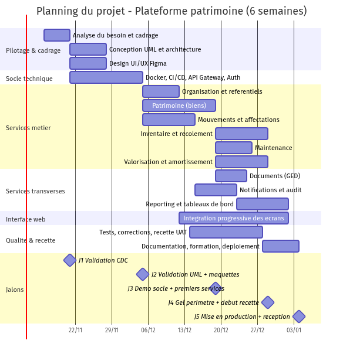

# Proposition financière — Plateforme de gestion du patrimoine de l'État togolais

| | |
|---|---|
| **Document** | Proposition financière détaillée (Étape 4) |
| **Version** | 1.0 |
| **Date** | 12 novembre 2026 |
| **Devise** | FCFA (XOF) — montants hors taxes, hors matériel |
| **Base** | Cahier des charges v1.0, §12 et §13 |

---

## 1. Synthèse

| Poste | Montant (FCFA) |
|---|---|
| Prestations de développement (229 jours-homme) | **6 870 000** |
| Provision pour imprévus et évolutions mineures (10 %) | 687 000 |
| Outils, licences et hébergement de recette (forfait projet) | 600 000 |
| **TOTAL GÉNÉRAL ESTIMÉ (hors taxes)** | **8 157 000** |

Taux journalier unique : **30 000 FCFA / jour-homme**, applicable à tous les profils.

## 2. Équipe et capacité de production

Le projet est réalisé en **6 semaines** en méthode agile (sprints d'une semaine). Un intervenant à temps plein fournit 5 jours-homme/semaine, soit 30 jours-homme sur la durée. Le volume de **229 jours-homme** exige une équipe de **9 intervenants** (capacité 270 j-h, taux d'occupation ~85 %, marge ~15 % pour aléas et coordination).

| Profil | Responsabilités | Jours-homme | Occupation |
|---|---|---|---|
| Concepteur et chef de projet (CHAOLD Komi Serge) | Analyse, UML, pilotage, documentation, guide | 30 | 100 % |
| Designer UI/UX et intégrateur front-end | Maquettes Figma, design system, écrans | 27 | 90 % |
| Ingénieur DevOps et architecte | API Gateway, auth, Docker, CI/CD | 23 | 77 % |
| Développeur back-end 1 | Service patrimoine (biens) | 25 | 83 % |
| Développeur back-end 2 | Organisation, mouvements, maintenance | 30 | 100 % |
| Développeur back-end 3 | Inventaire et valorisation | 27 | 90 % |
| Développeur back-end 4 | Reporting et documents | 23 | 77 % |
| Développeur front-end | Interface web + notifications | 23 | 77 % |
| Testeur QA / déploiement | Tests, recette, formation, production | 21 | 70 % |
| **Total** | | **229** | |

## 3. Découpage en lots et chiffrage

Chaque lot correspond à un ou plusieurs micro-services et à une ou plusieurs branches `feature/*`.

| Lot | Contenu | Jours-homme | Montant (FCFA) |
|---|---|---|---|
| L1 — Cadrage | Analyse du besoin, backlog MoSCoW, atelier de validation | 10 | 300 000 |
| L2 — Conception | Dossier UML complet, architecture, contrats d'API | 12 | 360 000 |
| L3 — Design | Charte, design system, maquettes, prototype Figma | 12 | 360 000 |
| L4 — Socle technique | Docker Compose, CI/CD, API Gateway, auth-service (JWT, RBAC, 2FA) | 15 | 450 000 |
| L5 — Organisation | Structures, sites, localisations, nomenclatures, paramètres | 8 | 240 000 |
| L6 — Patrimoine | Fiches biens, catégories, QR codes, import Excel/CSV, recherche | 25 | 750 000 |
| L7 — Mouvements | Entrées, affectations, transferts, sorties, workflows de validation | 12 | 360 000 |
| L8 — Inventaire | Campagnes, PWA hors-ligne, scan QR, écarts, récolement | 15 | 450 000 |
| L9 — Maintenance | Plans préventifs, pannes, ordres d'intervention, prestataires | 10 | 300 000 |
| L10 — Valorisation | Amortissements (linéaire/dégressif), VNC, réévaluations | 12 | 360 000 |
| L11 — Documents | GED : stockage, versionnage, contrôle formats, sécurisation | 8 | 240 000 |
| L12 — Notifications & audit | Alertes e-mail/internes, journal d'audit, files RabbitMQ | 8 | 240 000 |
| L13 — Reporting | Tableaux de bord, états standards, exports PDF/Excel/CSV | 15 | 450 000 |
| L14 — Interface web | Écrans métier Inertia/Vue, responsive, PWA inventaire | 30 | 900 000 |
| L15 — Conteneurisation | Dockerfiles multi-étapes, compose global, scripts init BDD | 8 | 240 000 |
| L16 — Tests & recette | Tests unitaires/intégration/E2E, sécurité, recette UAT | 15 | 450 000 |
| L17 — Documentation & déploiement | Guides, formation utilisateurs clés, mise en production | 14 | 420 000 |
| | **Sous-total** | **229** | **6 870 000** |

> Le lot L17 regroupe « documentation et guide » (8 j-h) et « formation et déploiement » (6 j-h) du CDC, soit 14 j-h.

## 4. Planning et jalons

Le planning prévisionnel (6 semaines) est détaillé au chapitre 12 du cahier des charges ; le diagramme de Gantt ci-dessous en est la restitution.

*Source : `sources/gantt.mmd` — exports `exports/gantt.svg` et `gantt.png`.*

### Jalons de validation

| Jalon | Échéance | Objet |
|---|---|---|
| J1 | Fin S1 | Validation du cahier des charges et du backlog priorisé |
| J2 | Fin S2 | Validation UML, maquettes, prototype ; socle technique lancé |
| J3 | Fin S3 | Démonstration du socle conteneurisé + premiers services |
| J4 | Fin S5 | Fonctionnalités complètes, gel du périmètre, début recette |
| J5 | Fin S6 | Recette finale, mise en production, réception |

## 5. Coûts annexes

### 5.1 Pendant le projet

| Poste | Montant (FCFA) | Détail |
|---|---|---|
| Outils, licences, hébergement de recette | 600 000 | Environnement de recette 4 vCPU/8 Go, nom de domaine, certificats TLS, licences éventuelles, forfait outils |
| Provision imprévus / évolutions mineures | 687 000 | 10 % du sous-total prestations |

### 5.2 Coûts récurrents (hors projet, après réception)

| Poste | Montant annuel estimé (FCFA) |
|---|---|
| Maintenance corrective et évolutive (≈ 15 % du coût de développement) | **1 030 500** |
| Hébergement de production, nom de domaine, TLS, sauvegardes | À déterminer selon l'infrastructure retenue (dimensionnement indicatif : 8 vCPU / 16 Go / 200 Go SSD + stockage sauvegarde ≥ 500 Go) |

### 5.3 Hors chiffrage

- Matériel : serveurs, lecteurs de codes-barres, terminaux mobiles (acquisition séparée).
- Reprise de données papier non numérisées (hors import de fichiers structurés).
- Évolutions de périmètre après gel : faire l'objet d'un avenant chiffré.

## 6. Échéancier de paiement proposé

| Étape | Part | Montant (FCFA) |
|---|---|---|
| Signature / validation du cahier des charges | 30 % | 2 447 100 |
| Validation de la conception et des maquettes | 20 % | 1 631 400 |
| Livraison des modules et recette fonctionnelle | 30 % | 2 447 100 |
| Mise en production, formation et réception définitive | 20 % | 1 631 400 |
| **Total** | **100 %** | **8 157 000** |

## 7. Options et hypothèses

### Options envisagées

| Option | Description | Impact |
|---|---|---|
| **A — Périmètre complet (recommandée)** | Les 12 micro-services + interface web + PWA inventaire, tel que spécifié | 8 157 000 FCFA, 6 semaines, 9 intervenants |
| **B — Socle + modules prioritaires** | Auth + organisation + patrimoine + mouvements + inventaire ; reporting et maintenance en phase 2 | ~5 900 000 FCFA estimés, même délai (équipe recentrée) |
| **C — allégé reporting** | Option A sans exports Excel avancés ni états personnalisés | ~7 600 000 FCFA (−550 000) |

### Hypothèses

1. Périmètre conforme au cahier des charges ; toute évolution fait l'objet d'un avenant chiffré.
2. Disponibilité des interlocuteurs métier pour ateliers et validations (délai de réponse < 48 h).
3. Infrastructure d'hébergement fournie ou commandée séparément.
4. Jeu de données initial (fichiers Excel/CSV des biens) fourni avant la semaine 3.
5. Équipe complète disponible dès le premier jour.
6. Montants hors taxes et hors matériel ; conditions de paiement à valider contractuellement.

### Conditions de réussite du délai (rappel CDC §12.4)

- Équipe de 9 intervenants à temps plein dès J1.
- Périmètre gelé fin S1 ; demandes nouvelles traitées en avenant ou post-production.
- Référents métier désignés, validations sous 48 h.
- Serveur compatible Docker disponible dès S1.
- Données de départ fournies avant S3.

---

*Document établi par CHAOLD Komi Serge — Concepteur et chef de projet.*
